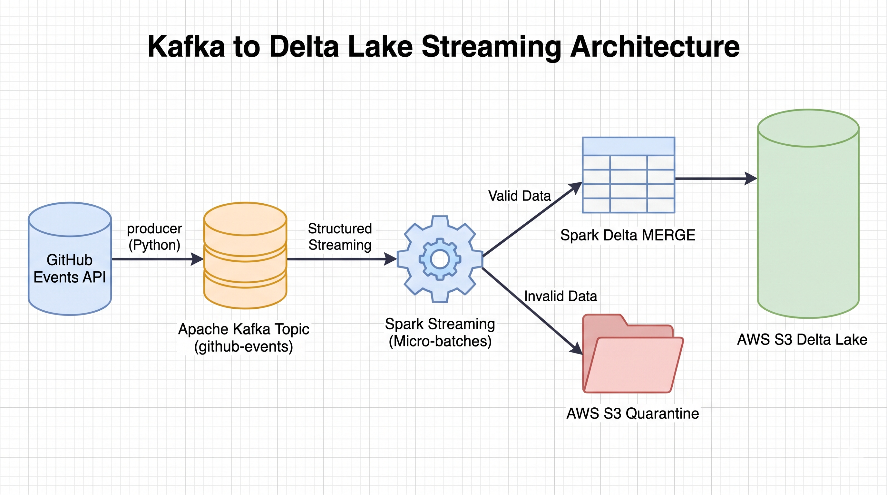

# GitHub Events Data Engineering Pipelines (Batch & Streaming)

> **Note:** This repository is a hands-on learning sandbox built to understand batch and real-time data engineering patterns (Airflow orchestration, Kafka streaming, PySpark transformations, quarantine routing, and idempotent Delta Lake `MERGE` upserts) ahead of integrating these components into a larger end-to-end data engineering project currently in progress.

## Architecture

1. **Batch Pipeline (`dags/github_to_s3.py` -> `delta_lake/s3_to_delta.py`)**
   * Extracts live public events from the GitHub Events API via Apache Airflow.
   * Deduplicates against an S3-backed checkpoint state (`checkpoints/github_event_ids.json`) and validates required fields before landing raw JSON files in AWS S3.
   * Triggers a PySpark job that enforces schema casting, routes invalid records to an S3 quarantine zone, fails fast if the bad-record rate exceeds 5%, and performs an idempotent Delta Lake `MERGE` upsert into S3.

2. **Streaming Pipeline (`github_producer.py` -> `delta_lake/kafka_to_delta.py`)**
   * Streams GitHub events into an Apache Kafka topic (`github-events`).
   * Consumes events via Spark Structured Streaming (`30s` micro-batches using `foreachBatch`), quarantining malformed records and merging deduplicated events into a separate Delta Lake table on S3.

## Project Structure

    data_pipelines/
    ├── dags/
    │   └── github_to_s3.py          # Airflow DAG for batch ingestion & Spark trigger
    ├── delta_lake/
    │   ├── s3_to_delta.py           # Batch PySpark validation, quarantine & Delta MERGE
    │   └── kafka_to_delta.py        # Structured Streaming consumer & Delta MERGE
    ├── github_producer.py           # Kafka producer publishing GitHub events
    ├── github_consumer.py           # Standalone Kafka consumer for topic debugging
    ├── basics/                      # Introductory Kafka & pipeline scripts
    ├── docker-compose.yml           # Local Kafka broker setup
    ├── pyproject.toml               # Python dependencies (managed via uv)
    └── .env.example                 # Template for required environment variables

## Setup & Usage

1. **Install dependencies**

       uv sync

2. **Configure environment variables**

       cp .env.example .env
       # Update AWS_BUCKET_NAME, AWS_REGION, and JAVA_17_HOME in .env

3. **Start local Kafka broker**

       docker compose up -d

4. **Run the pipelines**
   * **Streaming:** Start `python github_producer.py` and `python delta_lake/kafka_to_delta.py` in separate terminals.
   * **Batch:** Trigger the `github_to_s3` DAG in your local Apache Airflow UI.

## Key Learnings & Tool Notes

* **Apache Airflow (The Orchestrator):** Acts like a smart alarm clock and task manager. It runs pipeline steps in a strict order (extract $\rightarrow$ deduplicate $\rightarrow$ validate $\rightarrow$ upload $\rightarrow$ trigger Spark), automatically retries if an API hiccup occurs, and passes file locations between tasks using XComs.
* **Apache Kafka (The Live Event Conveyor Belt):** Holds a continuous stream of incoming GitHub events in a topic (`github-events`). It decouples producers (sending data) from consumers (reading data) so fast bursts of events never overwhelm the downstream processing engine.
* **PySpark & Structured Streaming (The Processing Engine):** Handles data transformations in both batch mode (reading whole JSON files from S3) and streaming mode (reading 30-second micro-batches from Kafka). Using `foreachBatch` lets a live stream run custom batch logic like splitting good and bad rows in a single pass.
* **Delta Lake (Reliable Storage on S3):** Adds database-like superpowers on top of plain cloud files. Using `DeltaTable.merge()` (upserts) ensures idempotency—meaning if a batch or stream accidentally processes the same event twice, duplicates are safely ignored instead of corrupting the table.
* **AWS S3 & Quarantine Pattern (Data Lake & Safety Net):** Stores raw JSON files, curated Delta tables, and checkpoints in separate prefixes. Routing malformed records to a dedicated `quarantine/` folder keeps bad data out of analytics tables while preserving it for debugging.

[def]: assets/kafka_to_delta_architecture.png